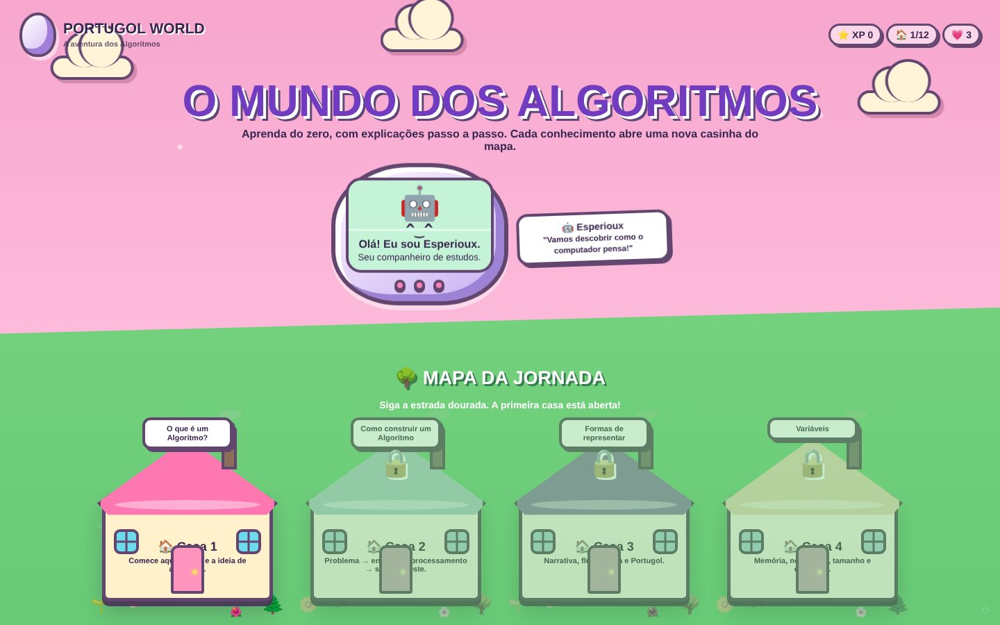

# Portugol World — A Jornada de Esperioux

Jogo educativo que ensina lógica de programação para quem nunca programou. O conteúdo é organizado como um mapa: cada "casa" é uma lição com explicação passo a passo e um quiz, e acertar o quiz abre a próxima casa. O guia da jornada é o Esperioux, um robô companheiro de estudos.

**Demo:** [liviavittoria28-create.github.io/engenharia](https://liviavittoria28-create.github.io/engenharia/)

## Conteúdo

| Casa | Tema |
|---|---|
| 1 | O que é um algoritmo |
| 2 | Como construir um algoritmo (entrada, processamento e saída) |
| 3 | Formas de representar: narrativa, fluxograma e Portugol |
| 4 | Variáveis |
| 5 | Tipos de dados |
| 6 | Sequência e operações |
| 7 | Decisões (`se` / `senao`) |
| 8 | Repetições (`enquanto`, `para`) |
| 9 | Problemas reais |
| 10 | Teste de mesa |
| 11 | Guia de bolso (resumo) |
| 👑 | Torre do BOSS: exame final |

A interface mostra XP, casas desbloqueadas e vidas restantes, para dar a sensação de progresso de um jogo.

## Tecnologias

HTML, CSS e JavaScript puros, em um único arquivo e sem dependências. Os cenários (céu, nuvens, casas, estrada) são desenhados com CSS, sem imagens. O layout se adapta ao celular.

## Como rodar

Abra `index.html` no navegador. Não precisa de instalação nem de servidor.

## Próximos passos

- Salvar o progresso no `localStorage`, para não recomeçar ao recarregar a página.

## Autora

Desenvolvido por **Lívia Vittoria** · [GitHub](https://github.com/liviavittoria28-create)
